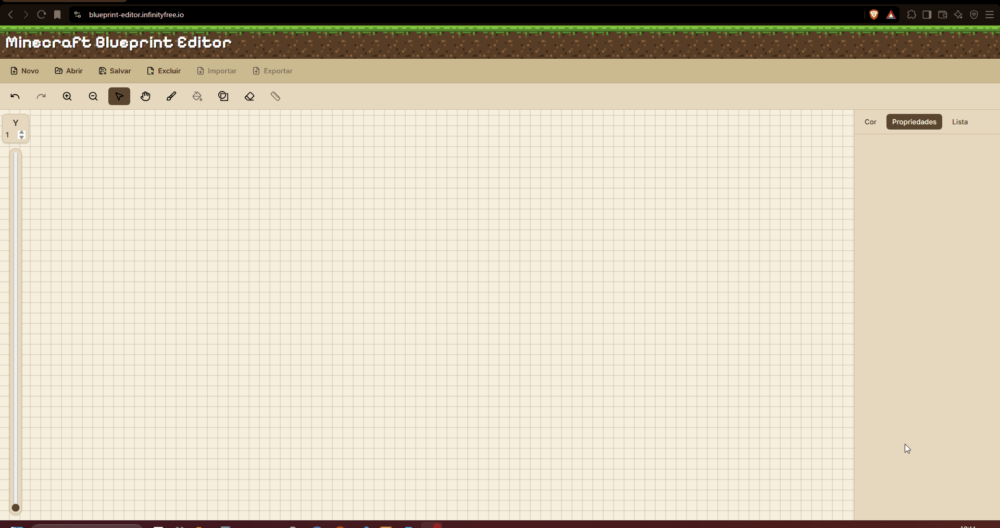
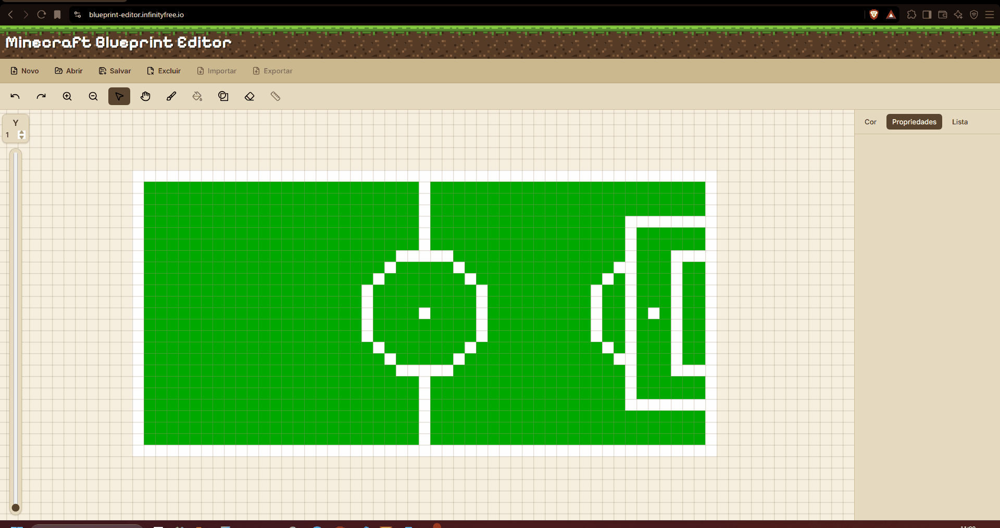
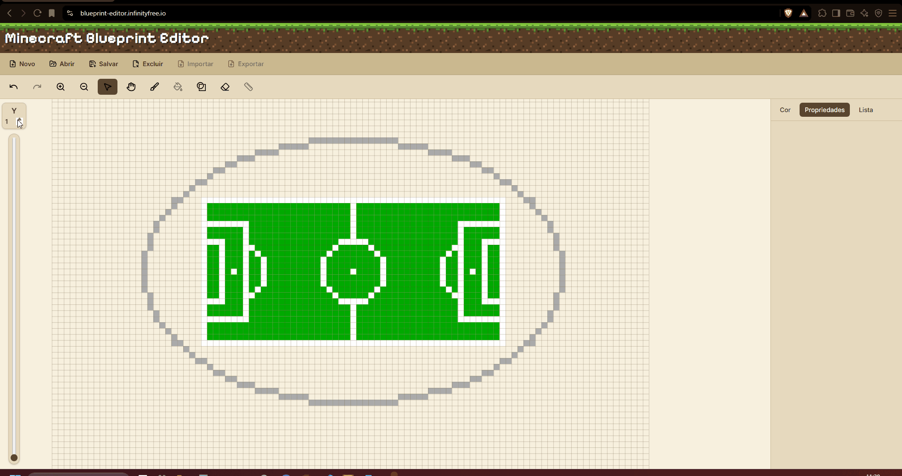

# Minecraft Blueprint Editor

O Minecraft Blueprint Editor consiste em um editor de imagem, similar ao Canva, Illustrator ou ao próprio Paint, porém configurado em um grid de blocos voltado para facilitar o
planejamento de construções no jogo Minecraft.

É um projeto acadêmico feito para a disciplina de PROJETO TECNOLÓGICO EM DESENVOLVIMENTO DE SISTEMAS, do curso de ADS EAD da ULBRA RS.

**Acesso online:** [https://blueprint-editor.infinityfree.io/](https://blueprint-editor.infinityfree.io/)

> Projeto acadêmico não oficial, sem vínculo com a Mojang ou a Microsoft.

## Demonstração e funcionalidades

O site permite criar, salvar, abrir e excluir projetos pelo banco de dados. Não é necessário login, pois o registro de usuário é feito por um ID de visitante gerado a partir do acesso.

O editor em si funciona de forma similar a outros programas do gênero, permitindo desenhar e criar formas com diferentes cores e formatos.

### Criar formas



Selecionando o botão de Formas na barra de ferramentas, o usuário consegue criar formas alterando suas propriedades na aba Propriedades. É possível criar polígonos de 3 a 32 lados ou superelipses com o expoente de 0,5 até 10, permitindo uma grande variedade de formas diferentes. Além disso também é possível rotacionar a forma livremente e escolher se ela deve ser preenchida ou apenas o contorno. Depois de confirmar a criação da forma, é possível editá-la novamente utilizando a ferramenta de Seleção (V) ou selecionando pela aba Lista no painel lateral.

### Pintar com o Pincel



Com a ferramenta Pincel (P) é possível pintar e recolorir células do grid individualmente, alterando a cor na aba Cor.

### Alternar camadas Y



Uma das funcionalidades que mais se destacam do site é a possibilidade de editar diferentes camadas, dessa forma é possível planejar construções com até 99 andares de altura.

### Outras funcionalidades

Entre outras ferramentas do site estão Desfazer (Ctrl+Z) e Refazer (Ctrl+Y) alterações, aumentar e diminuir visualização com Zoom in/out (Scroll), Selecionar formas existentes no grid com Seleção (V) e deletá-las com a tecla Delete, alterar pan de visualização com Mover (segurando barra de espaço) e apagar células individualmente com a Borracha (E).

Algumas funcionalidades que ainda estão para ser implementadas são Importar e Exportar projetos, pintar múltiplas células com Balde (B), selecionar múltiplas formas e células individuais com a ferramenta Seleção (V), podendo agrupá-las e bloqueá-las pela aba Lista, Copiar (Ctrl+C) e Colar (Ctrl+V) células e grupos e medir distância com a ferramenta auxiliar Régua (R).

## Tecnologias e versões

| Tecnologia | Uso no projeto | Versão |
| ---------- | -------------- | ------ |
| HTML5 / Canvas | Construção do grid | HTML5 |
| CSS | Aparência geral do site | CSS3 |
| JavaScript | Lógica das ferramentas e funcionalidades | JavaScript (ES2020+, módulos ES) |
| PHP | Conexão entre site e banco de dados | local: 8.2.12, site: 8.4.25 |
| MySQL / MariaDB | Gerenciamento do banco de dados | local: 10.4.32, site: 11.4.13 |


## Instalação e execução local

**Requisitos:** testado com XAMPP 8.2.12 (PHP 8.2.12 e MariaDB 10.4.32) e em um navegador baseado em Chromium com acesso a internet (para carregar as fontes).

1. Instale o XAMPP e, no painel de controle, inicie os módulos Apache e MySQL.
2. Baixe o projeto pelo repositório do GitHub (Code > Download ZIP ou git clone).
3. Copie a pasta de dentro do ZIP do projeto para `C:\xampp\htdocs\`, de modo que fique `C:\xampp\htdocs\minecraft-blueprint-editor`.
4. Abra `http://localhost/phpmyadmin`, clique em Novo e crie o banco `blueprint` com a collation `utf8mb4_unicode_ci`.
5. Com o banco selecionado, abra a aba Importar, escolha o arquivo `database/schema.sql` e execute.
6. Na pasta `config/`, copie `database.example.php` e renomeie a cópia para `database.php` (caso o MySQL tenha um nome de usuário diferente de root ou use senha, edite as linhas `user` e `pass`).
7. Abra `http://localhost/minecraft-blueprint-editor/` no navegador. Não abra o `index.html` com duplo clique: o endereço precisa começar com `http://` porque o navegador bloqueia módulos JavaScript em arquivos abertos no disco e o PHP só roda dentro do Apache.

**Como saber que deu certo:** a página inicial aparece e é possível criar um projeto novo. Após a criação, recarregar a página mantém o projeto aberto.

**Se der erro:** página em branco ou erro de conexão geralmente é o Apache não iniciado (passo 1). Caso a página abra mas não seja possível criar projetos, possivelmente é por conta do MySQL parado (passo 1), banco de dados inexistente (passos 4 e 5) ou arquivo `database.php` inexistente ou nomeado errado (passo 6).

## Estrutura do projeto e orientações para análise

### Estrutura do projeto

```
index.html (Estrutura da página)
+---api (Arquivos que conectam JS e PHP)
+---config (Arquivos de configuração e funções auxiliares do PHP)
+---css (Arquivo que define aparência geral do site)
+---database (Arquivo SQL que cria as tabelas do banco de dados)
+---docs (Gifs usados pelo README)
+---img (Ícones e banner)
|   \---icones (Ícones)
\---js (Arquivos de JavaScript gerais do site que guardam regras compartilhadas)
    +---ferramentas (Arquivos de JavaScript da barra de ferramentas)
    +---gestao (Arquivos de JavaScript da barra de gestão de projetos)
    \---painel (Arquivos de JavaScript do painel lateral)
```

### Orientação para análise

1. **Arquivos que carregam o site:** 

`index.html` => Estrutura do site, usa o `css/estilo.css` para aparência e carrega o `js/editor.js`.

`js/editor.js` => Carrega os 5 arquivos de ligação e execução que conectam com o resto.

2. **Arquivos de ligação e execução:**

`js/gestao.js` => Liga e executa os arquivos principais de `js/gestao/`.

`js/ferramentas.js` => Liga e executa os arquivos principais de `js/ferramentas/`.

`js/painel.js` => Liga e executa os arquivos principais de `js/painel/`.

`js/camada.js` => Usa arquivos de regras compartilhadas para desenhar a camada ativa.

`js/aviso.js` => Marca alterações pendentes e avisa antes de sair.

3. **Arquivos de regras compartilhadas:**

`js/estado.js` => Guarda o estado atual do editor (importado pela maioria dos arquivos).

`js/celulas.js` => Define o comportamento das células.

`js/grid.js` => Define o comportamento do grid.

`js/historico.js` => Guarda o registro de mudanças para o desfazer e refazer.

4. **Arquivos auxiliares:**

`js/geometria.js`, `js/forma.js` => Auxiliam na lógica de formas de `js/ferramentas/formas.js`.

`js/ferramentas/ativa.js` => Auxilia a definir ferramenta ativa.

`js/ferramentas/destaque.js` => Auxilia a definir célula destacada para `js/ferramentas/pincel.js` e `js/ferramentas/borracha.js`.

`js/notificacao.js`, `js/gestao/pendentes.js` => Auxiliam a mostrar notificações e identificar alterações pendentes.

 ,`js/gestao/lista.js` => Auxilia a montar a lista de projetos salvos para `js/gestao/abrir.js` e `js/gestao/excluir.js`.

`js/armazenamento.js`, `js/gestao/reabrir.js` => Guarda e reabre o último projeto aberto.

5. **Banco de dados:**

`api/` => Arquivos que fazem a ponte entre `js/gestao` e os demais PHP.

`config/conexao.php` => Abre a conexão com o banco de dados.

`config/visitante.php` => Identifica o visitante (ID e cookie).

`config/projeto.php` => Funções que inserem, leem, atualizam e removem projetos do banco de dados.

`config/database.php`, `database/schema.sql` => Arquivos que guiam a criação e o acesso do banco de dados.


## Atalhos de teclado

| Atalho | Ação |
| ------ | ---- |
| Ctrl+Z | Desfazer |
| Ctrl+Y | Refazer |
| Scroll do Mouse | Zoom in/out |
| V | Seleção |
| Barra de espaço (segurar) | Mover |
| P | Pincel |
| E | Borracha |
| Delete | Apagar forma selecionada |
| Enter | Confirmar campo |
| Esc | Cancelar campo |

## Créditos e licenças

Ícones do site: Lucide (ISC) [https://lucide.dev/icons/](https://lucide.dev/icons/)

Banner: Recurso gerado por IA (Gemini)

Fontes: Pixelify Sans (SIL Open Font License), Inter

O nome Minecraft é uma marca registrada e propriedade intelectual da Mojang AB / Microsoft Corporation. Este conteúdo não é oficial e não possui afiliação, patrocínio ou aprovação da Mojang ou da Microsoft.

## Autor

Bruno do Carmo Dias Larronde

[https://github.com/Fooeks](https://github.com/Fooeks)